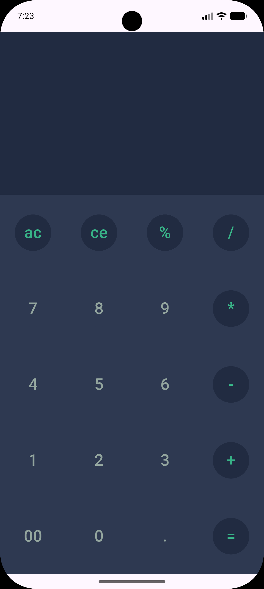
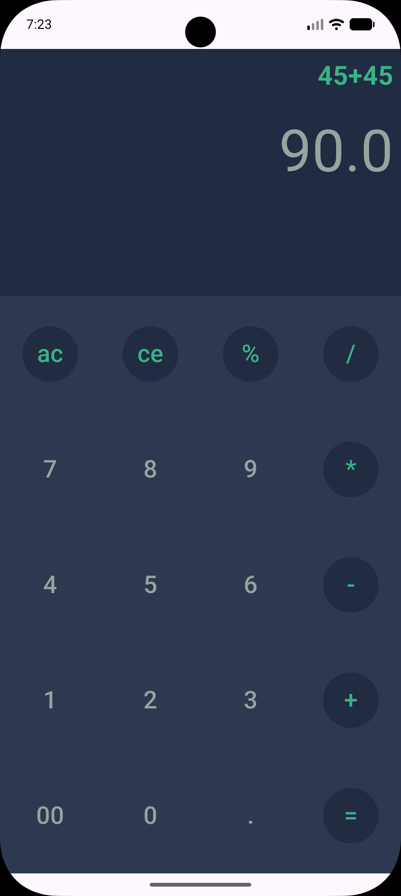
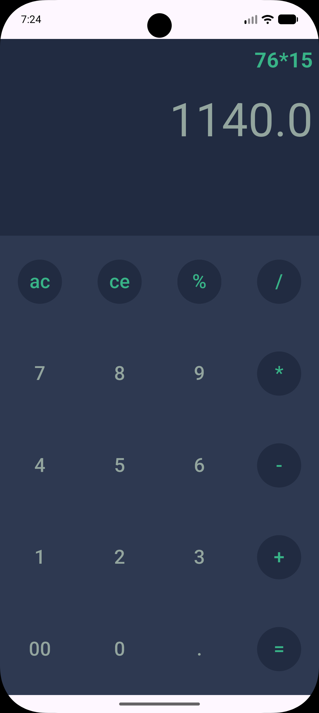
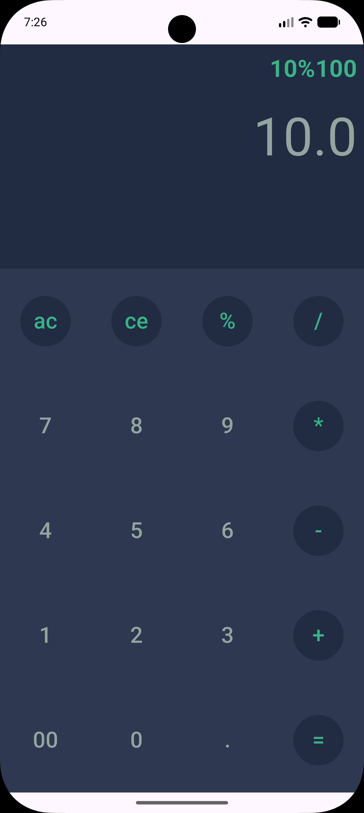

<div dir="rtl" align="right">

[English](README.md) | [فارسی](README.fa.md)

# ماشین‌حساب Flutter

یک ماشین‌حساب کوچک با Flutter؛ با صفحه‌کلید تیره، نمایش جداگانهٔ عبارت و نتیجه، و محاسبهٔ عبارت‌ها روی خود دستگاه. رابط کاربری و منطق محاسبه در دو فایل Dart قرار دارند و برنامه به بک‌اند یا پکیج جداگانه‌ای برای State Management نیاز ندارد.


[](LICENSE)

## تصاویر برنامه

| صفحه‌کلید | جمع | ضرب | عملگر `%` |
| :---: | :---: | :---: | :---: |
|  |  |  |  |

این تصاویر در پوشهٔ `assets/screenshots/` قرار دارند. برای به‌روزرسانی گالری، فایل‌های تصویر را جایگزین کنید یا مسیرهای جدول را تغییر دهید. تصاویر فقط برای مستندات هستند و نیازی نیست در `pubspec.yaml` ثبت شوند.

## امکانات

- جمع، تفریق، ضرب و تقسیم؛ با پردازش عبارت‌ها توسط `math_expressions`.
- ورود عددهای اعشاری و دکمهٔ `00` برای وارد کردن دو صفر.
- نمایش جداگانهٔ عبارت فعلی و آخرین نتیجهٔ محاسبه‌شده.
- دکمهٔ `ac` عبارت و نتیجه را پاک می‌کند؛ دکمهٔ `ce` آخرین کاراکتر ورودی را حذف می‌کند.
- دکمهٔ `=` نتیجه را بدون پاک کردن عبارت محاسبه می‌کند؛ بنابراین بعد از محاسبه هم می‌توان عبارت را ویرایش کرد.
- رنگ‌بندی ثابت و تیره، دکمه‌های عملگر سبز، و صفحه‌کلید پنج‌ردیفی با ویجت‌های Material.
- محاسبات روی خود دستگاه انجام می‌شوند. برای استفاده از ماشین‌حساب به حساب کاربری، API یا اتصال اینترنت نیازی نیست.

### رفتار فعلی و محدودیت‌ها

دکمهٔ `%` این نماد را مستقیم به پارسر عبارت می‌فرستد؛ برنامه منطق جداگانه‌ای برای تبدیل درصد ندارد. خطاهای عبارت‌های نامعتبر یا ناقص مدیریت نمی‌شوند و پیام خطای مناسبی به کاربر نمایش داده نمی‌شود. هنگام ویرایش عبارت، نتیجهٔ قبلی روی صفحه می‌ماند تا دوباره `=` زده شود یا `ac` آن را پاک کند. تاریخچهٔ محاسبات، ذخیرهٔ وضعیت، تغییر تم و صفحه‌کلید علمی هم در نسخهٔ فعلی وجود ندارند.

## تکنولوژی‌ها و معماری

نام پکیج پروژه `calculator_application` و نسخهٔ آن `1.0.0+1` است. محدودیت نسخهٔ Dart در پروژه `^3.12.0` است؛ یعنی `>=3.12.0 <4.0.0`. از نسخه‌ای از Flutter استفاده کنید که Dart سازگار با این محدودیت را داشته باشد. پیکربندی محلی پکیج‌ها با Flutter `3.44.0` و Dart `3.12.0` تولید شده است.

### ساختار پروژه

<div dir="ltr" align="left">

```text
calculator_application/
├── lib/
│   ├── main.dart          # App entry point, calculator UI, input and evaluation
│   └── constants.dart     # Shared text and background colors
├── assets/
│   └── screenshots/       # Four images used in this README
├── android/               # Android host and build configuration
├── web/                   # Browser host and app manifest
├── windows/               # Windows runner and build configuration
├── analysis_options.yaml  # flutter_lints configuration
├── pubspec.yaml           # Package metadata and dependency constraints
├── pubspec.lock           # Resolved dependency versions
└── LICENSE                # MIT license
```

</div>

این پروژه یک برنامهٔ کوچک و تک‌صفحه‌ای است، نه پروژه‌ای لایه‌بندی‌شده با Clean Architecture یا MVVM. ویجت `Application` از نوع `StatefulWidget` است. کلاس `_ApplicationState` دو رشتهٔ `inputUser` و `result` را نگه می‌دارد و با `setState` رابط کاربری را به‌روزرسانی می‌کند. متد `getRow` هر ردیف دکمه‌ها را می‌سازد. با زدن `=`، عبارت ورودی توسط `GrammarParser` پردازش و با `RealEvaluator` و `ContextModel` محاسبه می‌شود.

لایه‌های جداگانهٔ Data، Domain یا Repository در پروژه وجود ندارند. برنامه از BLoC، Provider، Riverpod یا پکیج‌های شبکه و ذخیره‌سازی محلی استفاده نمی‌کند. رنگ‌های مشترک صفحه در `constants.dart` تعریف شده‌اند. در ساختار بالا، `main.dart` نقطهٔ شروع برنامه و محل رابط کاربری و محاسبات است؛ پوشه‌های پلتفرم هم تنظیمات اجرا و بیلد هر پلتفرم را نگه می‌دارند.

### پکیج‌ها

نسخه‌های زیر محدودیت‌های تعریف‌شده در `pubspec.yaml` هستند و لزوماً با نسخه‌های دقیق ثبت‌شده در `pubspec.lock` یکسان نیستند.

- **`flutter` از SDK:** ویجت‌های Material، چیدمان صفحه و APIهای داخلی `StatefulWidget` و `setState`.
- **`math_expressions: ^3.2.0`:** پردازش و محاسبهٔ عبارت ورودی.
- **`hexcolor: ^3.1.3`:** تبدیل مقدارهای رنگ هگز در `constants.dart` به رنگ‌های Flutter.
- **`cupertino_icons: ^1.0.8`:** در وابستگی‌ها تعریف شده، اما صفحهٔ فعلی ماشین‌حساب از آن استفاده نمی‌کند.
- **`flutter_lints: ^6.0.0`، وابستگی توسعه:** قواعد پیشنهادی Lint برای Dart و Flutter که در `analysis_options.yaml` فعال شده‌اند.
- **`flutter_test` از SDK، وابستگی توسعه:** ابزارهای تست Flutter. در حال حاضر فایل تستی در مخزن وجود ندارد.

## راه‌اندازی

### ۱. آماده کردن محیط

Flutter را با Dart نسخهٔ `3.12.x` یا نسخهٔ دیگری که محدودیت `^3.12.0` اجازه می‌دهد نصب کنید و Flutter را به `PATH` اضافه کنید. قبل از اجرا، وضعیت ابزارها را بررسی کنید:

<div dir="ltr" align="left">

```bash
flutter --version
flutter doctor
```

</div>

پوشه‌های پلتفرم **Android، وب و Windows** در این مخزن وجود دارند. برای Android از شبیه‌ساز یا دستگاه متصل، برای وب از Chrome، و برای بیلد Windows از ویندوز و Visual Studio با ورک‌لود **Desktop development with C++** استفاده کنید. بیلد Android به Android SDK و یک JDK سازگار با تنظیمات Gradle پروژه هم نیاز دارد؛ نسخهٔ هدف Java و Kotlin JVM در تنظیمات برنامه ۱۷ است. پوشه‌های iOS، macOS و Linux در این نسخهٔ مخزن وجود ندارند.

### ۲. کلون کردن مخزن

<div dir="ltr" align="left">

```bash
git clone https://github.com/mehrshadkhv/calculator_application.git
cd calculator_application
```

</div>

اگر از قبل یک نسخهٔ محلی دارید، کافی است ترمینال را در پوشهٔ اصلی پروژه باز کنید.

### ۳. نصب وابستگی‌ها

<div dir="ltr" align="left">

```bash
flutter pub get
```

</div>

نیازی به اجرای Code Generation نیست. در پروژه وابستگی‌هایی مثل `build_runner`، Freezed یا ابزارهای دیگر تولید کد تعریف نشده‌اند.

### ۴. اجرای برنامه

شبیه‌ساز را اجرا کنید یا دستگاه را وصل کنید، سپس دستورهای زیر را بزنید:

<div dir="ltr" align="left">

```bash
flutter devices
flutter run
```

</div>

برای انتخاب مستقیم نسخهٔ وب، با نصب بودن Chrome، از این دستور استفاده کنید:

<div dir="ltr" align="left">

```bash
flutter run -d chrome
```

</div>

برای نسخهٔ Windows، این دستور را روی ویندوز و با نصب بودن ابزارهای C++ اجرا کنید:

<div dir="ltr" align="left">

```bash
flutter run -d windows
```

</div>

### بررسی‌های توسعه

برای اجرای تحلیل استاتیک، در پوشهٔ اصلی پروژه این دستور را بزنید:

<div dir="ltr" align="left">

```bash
flutter analyze
```

</div>

پکیج `flutter_test` برای اضافه کردن تست در دسترس است، اما هنوز پوشهٔ `test/` وجود ندارد. بعد از اضافه کردن تست‌ها می‌توانید آن‌ها را با دستور زیر اجرا کنید:

<div dir="ltr" align="left">

```bash
flutter test
```

</div>

## مجوز

پروژه با [مجوز MIT](LICENSE) منتشر شده است. حق نشر © ۲۰۲۶ متعلق به Mehrshad Khodavirdizadeh است.

</div>
